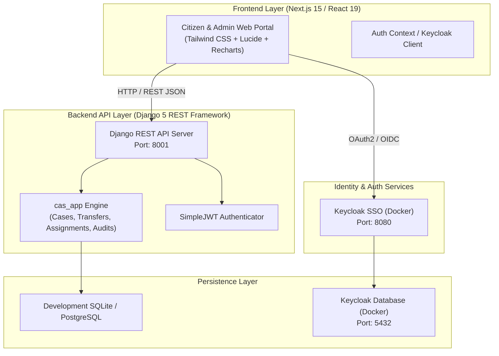

# Complaint & Appeal Resolution System (CAS)

[](https://nextjs.org/)
[](https://react.dev/)
[](https://www.typescriptlang.org/)
[](https://www.djangoproject.com/)
[](https://www.django-rest-framework.org/)
[](https://tailwindcss.com/)
[](https://www.docker.com/)

An enterprise-grade, full-stack **Complaint and Appeal Management System (CAS)** designed for public institutions and corporate organizations. The platform streamlines citizen grievances and appeal lifecycle tracking, inter-departmental transfers, staff assignments, automated status audits, and executive analytics.

---

## Table of Contents

- [Key Capabilities](#key-capabilities)
- [System Architecture](#system-architecture)
- [User Roles & Permissions](#user-roles--permissions)
- [Tech Stack](#tech-stack)
- [Repository Structure](#repository-structure)
- [Getting Started](#getting-started)
  - [Prerequisites](#prerequisites)
  - [1. Backend Setup (Django)](#1-backend-setup-django)
  - [2. Frontend Setup (Next.js)](#2-frontend-setup-nextjs)
  - [3. Docker Services (Keycloak & PostgreSQL)](#3-docker-services-keycloak--postgresql)
- [Environment Configuration](#environment-configuration)
- [API Overview](#api-overview)
- [Case Lifecycle Workflow](#case-lifecycle-workflow)
- [Contributing & License](#contributing--license)

---

## Key Capabilities

- **Citizen Self-Service Portal**: Submit complaints and appeals across multiple categories (Land, Education, Infrastructure, Healthcare, Human Rights, etc.), upload attachments, and track real-time status.
- **Inter-Office Transfers & Assignments**: Route cases between organizational offices or assign them to specific officers with strict due dates and countdown tracking.
- **Audit Trail & History**: Complete immutable chronological history for every status change, assignment, and transfer.
- **Citizen Feedback & Ratings**: Collect citizen feedback and satisfaction ratings once a grievance is resolved.
- **Executive Analytics & Dashboards**: High-level visualizations for Directors and Executive Offices featuring case volume, department resolution rates, category breakdowns, and resolution turnaround times.
- **Targeted Announcements**: Publish priority announcements targeted by specific roles or designated organizational offices.
- **Internationalization (i18n)**: Multi-language support with instant locale switching powered by `react-i18next`.
- **Hybrid Authentication**: Dual-mode authentication supporting local JWT auth and enterprise Keycloak Single Sign-On (SSO) with mock bypass for local testing.

---

## System Architecture



---

## User Roles & Permissions

| Role | Scope & Permissions |
| :--- | :--- |
| **Citizen** | Submit grievances/appeals, upload evidence, track personal cases, and submit satisfaction feedback. |
| **Focal Point / Officer** | Investigate assigned cases, update investigation findings, request inter-office transfers, and submit resolutions. |
| **Director / Office Head** | Manage department cases, oversee officer workloads, reassign cases, publish department announcements, and review resolution reports. |
| **President / Executive** | Organization-wide visibility, system-wide macro analytics, policy escalations, and global broadcast announcements. |
| **Super Administrator** | Manage system offices, configure user accounts & national IDs, manage user groups, and oversee audit logs. |

---

## Tech Stack

### Frontend
- **Framework**: [Next.js 15](https://nextjs.org/) (App Router, Server & Client Components)
- **Library**: [React 19](https://react.dev/)
- **Styling**: [Tailwind CSS 3.4](https://tailwindcss.com/) & CSS Modules
- **UI Components**: Radix UI primitives, Lucide Icons, Framer Motion
- **Visualizations**: [Recharts](https://recharts.org/) & [ApexCharts](https://apexcharts.com/)
- **State & Network**: Axios, Context API, i18next & `react-i18next`

### Backend
- **Framework**: [Django 5.2](https://www.djangoproject.com/)
- **API**: [Django REST Framework (DRF)](https://www.django-rest-framework.org/)
- **Authentication**: `djangorestframework-simplejwt`, Django Auth, CORS Headers
- **Filtering**: `django-filter`
- **Database**: SQLite3 (default for local development) / PostgreSQL (production-ready)

### Infrastructure & Security
- **Containerization**: Docker Compose
- **Identity Provider**: Keycloak 24.0 (Red Hat SSO)
- **Database Service**: PostgreSQL 15

---

## Repository Structure

```text
complaint-resolution-system/
├── backend/                  # Django REST API Backend
│   ├── CAS/                  # Django project root (settings, urls, wsgi)
│   ├── cas_app/              # Core business application
│   │   ├── migrations/       # Database schema migrations
│   │   ├── management/       # Seeding and CLI commands
│   │   ├── models.py         # Data models (Case, Office, Assignment, Transfer, etc.)
│   │   ├── serializers.py    # DRF serializers
│   │   ├── api.py            # API ViewSets & endpoints
│   │   ├── urls.py           # Application route definitions
│   │   └── views.py          # Authentication and custom views
│   ├── db.sqlite3            # SQLite database with sample records
│   ├── manage.py             # Django management entry point
│   ├── requirements.txt      # Python dependencies
│   └── venv/                 # Python virtual environment (ignored in git)
├── frontend/                 # Next.js 15 Frontend
│   ├── public/               # Static assets, fonts, brand logos, icons
│   ├── src/
│   │   ├── app/              # Next.js App Router (pages and layouts)
│   │   │   ├── (home)/       # Landing and overview views
│   │   │   ├── announcements/# Announcement boards
│   │   │   ├── cases/        # Case filing, listing, activity & details
│   │   │   ├── dashboard/    # Role-based dashboards
│   │   │   ├── offices/      # Office registry
│   │   │   ├── reports/      # Statistical reports
│   │   │   └── users/        # User administration
│   │   ├── components/       # Reusable UI widgets, charts, and tables
│   │   ├── hooks/            # Custom React hooks
│   │   ├── lib/              # Auth, Keycloak, utilities, and i18n
│   │   └── services/         # API integration client services
│   ├── .env                  # Frontend runtime environment variables
│   ├── package.json          # Node.js dependencies and scripts
│   ├── tailwind.config.ts    # Tailwind design tokens
│   └── tsconfig.json         # TypeScript configuration
├── docker-compose.yml        # Keycloak and PostgreSQL container orchestration
├── .gitignore                # Source control ignore rules
└── README.md                 # Project documentation
```

---

## Getting Started

### Prerequisites

Ensure you have installed:
- **Python**: `3.11` or `3.12` ([python.org](https://www.python.org/))
- **Node.js**: `v18.x`, `v20.x`, or `v22.x` & npm ([nodejs.org](https://nodejs.org/))
- **Git**: ([git-scm.com](https://git-scm.com/))
- *(Optional)* **Docker Desktop**: For Keycloak and PostgreSQL containers ([docker.com](https://www.docker.com/))

---

### 1. Backend Setup (Django)

1. Open a terminal in the project root:
   ```bash
   cd backend
   ```

2. Create and activate a Python virtual environment:
   - **Windows (PowerShell)**:
     ```powershell
     python -m venv venv
     .\venv\Scripts\activate
     ```
   - **Linux / macOS**:
     ```bash
     python3 -m venv venv
     source venv/bin/activate
     ```

3. Install required packages:
   ```bash
   pip install -r requirements.txt
   ```

4. Apply database migrations:
   ```bash
   python manage.py migrate
   ```

5. *(Optional)* Seed initial data:
   ```bash
   python manage.py seed_cas
   ```

6. Start the Django development server on port **8001**:
   ```bash
   python manage.py runserver 8001
   ```
   Backend API is running at: `http://127.0.0.1:8001/api/`  
   Admin Portal is available at: `http://127.0.0.1:8001/admin/`

---

### 2. Frontend Setup (Next.js)

1. Open a second terminal window:
   ```bash
   cd frontend
   ```

2. Install dependencies:
   ```bash
   npm install
   ```

3. Ensure your local `.env` exists:
   ```bash
   cp .env.sample .env
   ```
   *(By default, `.env` is already configured for local testing with `NEXT_PUBLIC_USE_MOCK=1` and `NEXT_PUBLIC_API_URL=http://127.0.0.1:8001/api`)*.

4. Start the frontend development server:
   ```bash
   npm run dev
   ```

5. Open your browser and navigate to:
   ```text
   http://localhost:3000
   ```

---

### 3. Docker Services (Keycloak & PostgreSQL)

If you wish to run the full Keycloak enterprise SSO service:

```bash
docker compose up -d
```

- **Keycloak Admin Console**: `http://localhost:8080` (User: `admin` / Password: `admin`)
- **Keycloak Realm**: `complain-and-appeal`
- **PostgreSQL**: `localhost:5432` (User: `keycloak` / Password: `keycloak`)

To switch the frontend from mock mode to live Keycloak authentication, set `NEXT_PUBLIC_USE_MOCK=0` inside `frontend/.env`.

---

## Environment Configuration

### Frontend (`frontend/.env`)

| Variable | Description | Default Value |
| :--- | :--- | :--- |
| `NEXT_PUBLIC_API_URL` | Backend Django REST API base URL | `http://127.0.0.1:8001/api` |
| `NEXT_PUBLIC_USE_MOCK` | Enable mock authentication bypass (`1` = yes, `0` = no) | `1` |
| `KEYCLOAK_URL` | Keycloak server base URL | `http://localhost:8080` |
| `KEYCLOAK_REALM` | Keycloak target realm | `complain-and-appeal` |
| `KEYCLOAK_CLIENT_ID` | OIDC Client ID | `nextjs-frontend` |
| `PORT` | Frontend HTTP port | `3000` |

---

## API Overview

The backend exposes a RESTful API under `/api/`:

| Method | Endpoint | Description |
| :--- | :--- | :--- |
| `POST` | `/api/login/` | Authenticate user & retrieve JWT access/refresh tokens |
| `POST` | `/api/logout/` | Revoke session / logout user |
| `GET` | `/api/auth/me/` | Fetch authenticated user profile & role |
| `GET`/`POST` | `/api/cases/` | List complaints or submit a new grievance |
| `GET`/`PATCH` | `/api/cases/{id}/` | Retrieve case details, history, or update status |
| `GET`/`POST` | `/api/offices/` | List and register organizational offices |
| `GET`/`POST` | `/api/transfers/` | View and initiate inter-office case transfers |
| `GET`/`POST` | `/api/assignments/` | View and assign cases to individual officers |
| `GET`/`POST` | `/api/announcements/` | Retrieve and post role/office targeted announcements |
| `GET` | `/api/reports/` | Aggregate reporting and statistical case distribution |

---

## Case Lifecycle Workflow

```text
[Citizen Files Case] 
         │
         ▼
    ( Pending ) ──────► [Inter-Office Transfer] ──► (Transferred)
         │                                               │
         ▼                                               ▼
[Officer Assignment] ──────────────────────────► ( In Investigation )
                                                         │
                                    ┌────────────────────┴────────────────────┐
                                    ▼                                         ▼
                               ( Resolved )                              ( Rejected )
                                    │
                                    ▼
                         [Citizen Feedback & Rating]
                                    │
                                    ▼
                                 ( Closed )
```

---

## Contributing & License

1. Fork the repository.
2. Create a feature branch: `git checkout -b feature/my-new-feature`
3. Commit your changes: `git commit -m "Add new feature"`
4. Push to branch: `git push origin feature/my-new-feature`
5. Open a Pull Request.

Distributed under the **MIT License**.
